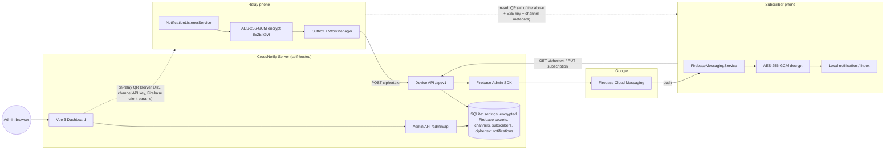
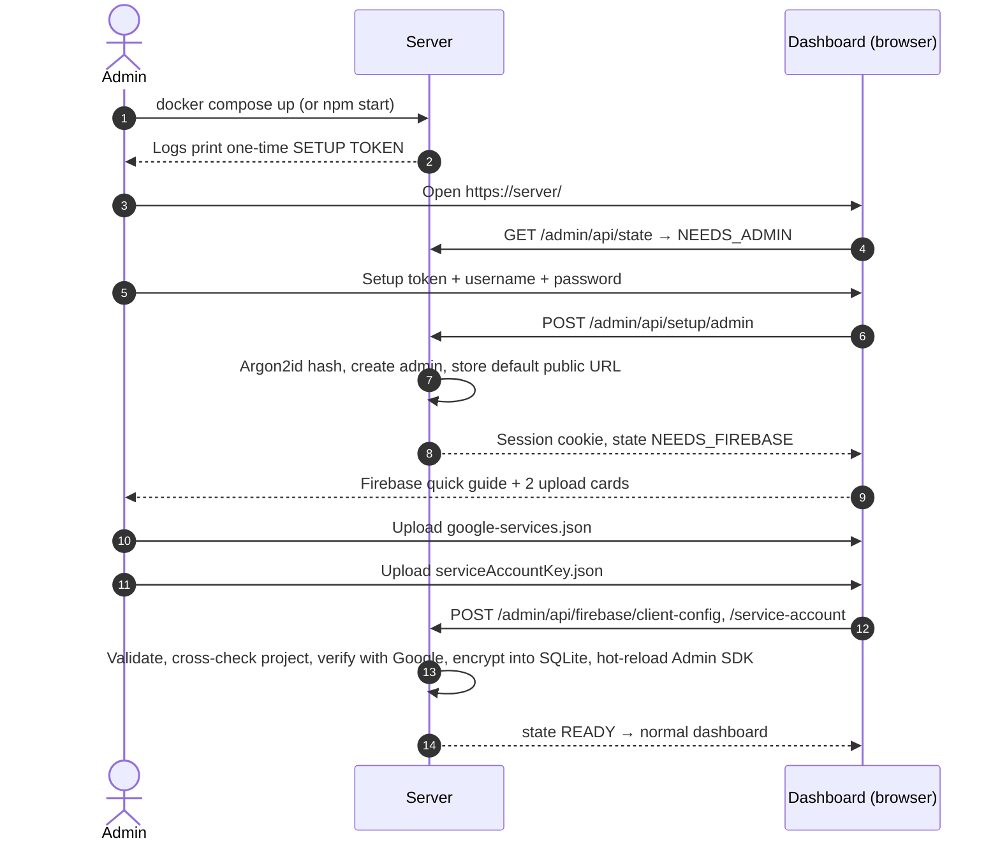
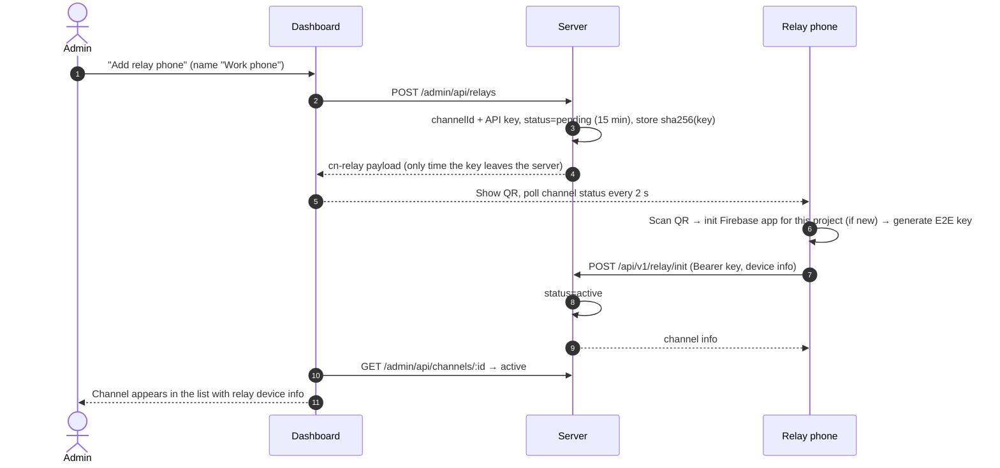
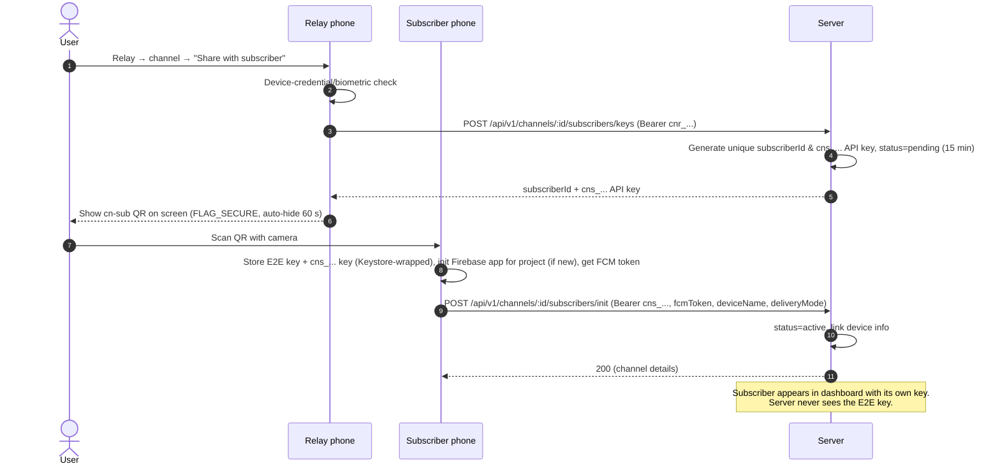
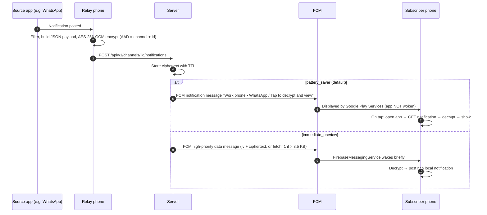

# CrossNotify — System Architecture

> **Audience**: Developers, contributors, and system architects.
> Related documents:
> - [SERVER_DOCUMENTATION.md](./SERVER_DOCUMENTATION.md): Detailed server, database, and dashboard documentation
> - [FIREBASE_SETUP_GUIDE.md](./FIREBASE_SETUP_GUIDE.md): Guide for creating and configuring Firebase credentials
> - [server/README.md](./server/README.md): Server operator and deployment documentation
> - [android/README.md](./android/README.md): Android client build and architecture documentation

---

## 1. Overview

**CrossNotify** relays Android notifications from one phone (a **relay**) to one or more other phones (**subscribers**). Notifications are **end-to-end encrypted**: they are encrypted on the relay phone and decrypted only on subscriber phones. The self-hosted server stores and forwards ciphertext it cannot read. Delivery uses **Firebase Cloud Messaging (FCM)**, which is free, to avoid battery-draining background connections.

CrossNotify is designed as an **open-source, self-hosted** system:
- Users run **their own server** (locally, on a home server, or on a cloud VM).
- Users create **their own Firebase project**. No shared Firebase project is required or provided.
- Users install a **single precompiled APK**. The app configures Firebase **at runtime** from QR codes, requiring no build-time credentials or compilation from source.

### Design Principles
1. **Zero-knowledge server**: E2E keys are generated on the relay phone and shared with subscribers strictly through a QR code scanned in person. The server and Google never see notification content or E2E keys.
2. **Physical-proximity pairing**: Every trust relationship is established by scanning a QR code on a nearby screen.
3. **Battery first**: No persistent background sockets. FCM wakes the device, and the default delivery mode (`battery_saver`) does not wake the application process at all.
4. **Zero-config deployment**: The server is configured entirely through its web dashboard, and a phone is configured entirely through QR codes.
5. **Multi-role, multi-server**: Any phone can act as a relay for multiple channels and subscribe to multiple channels across different servers, each backed by a different Firebase project. Daisy chaining naturally emerges from this design.

---

## 2. Terminology

| Term | Meaning |
| :--- | :--- |
| **Server** | A CrossNotify server instance (Node.js + Express + SQLite + Vue dashboard), bound to exactly one Firebase project |
| **Admin** | The person who operates a server through its dashboard (single account per server) |
| **Channel** | A one-way notification stream from one relay phone to N subscribers on one server. Identified by a server-generated UUID |
| **Channel API key** | Server-generated secret (`cnr_…`), one per channel. Authenticates the relay to the server |
| **Subscriber API key** | Server-generated secret (`cns_…`), unique per subscriber. Authenticates a specific subscriber device to the server |
| **E2E key** | 256-bit AES key generated **on the relay phone**, one per channel. Encrypts notification content. Never sent to the server |
| **Relay phone** | A phone running CrossNotify whose *Relay* section manages one or more outgoing relay channels |
| **Subscriber phone** | A phone running CrossNotify whose *Subscriptions* section holds one or more incoming subscriptions |
| **Relay provisioning QR** (`cn-relay`) | Displayed by the **server dashboard**. Pairs a phone as the relay of a new channel |
| **Subscriber pairing QR** (`cn-sub`) | Displayed by the **relay phone**. Subscribes another phone to that channel. Contains the E2E key |

> [!IMPORTANT]
> There are exactly **two** QR codes in the system. The **dashboard** produces `cn-relay`. The **relay phone** produces `cn-sub`. The server cannot produce a subscription QR because it never possesses the E2E key.

---

## 3. Architecture



### Knowledge Matrix

| Data | Server | Google (FCM) | Relay | Subscriber |
| :--- | :---: | :---: | :---: | :---: |
| Notification title & body text | ❌ | ❌ | ✅ | ✅ |
| Notification app icon | ❌ | ❌ | ✅ | ✅ |
| E2E key | ❌ | ❌ | ✅ | ✅ |
| Channel & subscriber API keys | hash only | ❌ | ✅ (relay key) | ✅ (subscriber key) |
| Channel name, relay device name | ✅ | battery-saver title only | ✅ | ✅ |
| Source app name (e.g. "WhatsApp") | ✅ (optional, per channel) | battery-saver title only | ✅ | ✅ |
| Timing and volume of notifications | ✅ | ✅ | ✅ | ✅ |
| Firebase service account key | ✅ (encrypted at rest) | – | ❌ | ❌ |
| Firebase client params (public identifiers) | ✅ | – | ✅ | ✅ |

---

## 4. End-to-End Flows

### 4.1 Server Setup (One Time)



### 4.2 Relay Provisioning (Dashboard → Relay Phone)



### 4.3 Subscriber Pairing (Relay Phone → Subscriber Phone, In Person)



### 4.4 Notification Delivery



### 4.5 Catch-Up Sync
When the app opens (and when the device regains connectivity, managed via WorkManager with a network constraint), each subscription queries `GET /api/v1/channels/:id/notifications?since=<lastReceivedAt>` and pages through until `hasMore=false`. The notifications are saved into the local inbox. Deduplication is performed by `notificationId`.

### 4.6 Daisy Chaining
A phone that subscribes to channel A (on server 1) and relays channel B (on server 2) can forward notifications from A to B:
- Each subscription provides an optional setting, **"Forward to relay channel"** (selecting one of the phone's active relay channels).
- Forwarding requires that subscription to use **`immediate_preview`**, because content must be decrypted on arrival to be re-encrypted.
- Forwarding is performed **internally**: the payload is decrypted with A's key, re-encrypted with B's key, and enqueued in B's local outbox. It does **not** loop through the `NotificationListenerService`. The listener **always ignores CrossNotify's own package**, preventing locally displayed notifications from being re-captured.
- **Loop prevention**: The encrypted payload carries an origin structure `{ id, hops, path[] }`. Each hop increments `hops` and appends the outgoing channel ID to `path`. The payload is dropped if `hops >= 3` or the target channel ID is already in `path`. The original `origin.id` is preserved, allowing every device in the chain to deduplicate by origin ID.

---

## 5. QR Code Formats

Both QR codes encode **UTF-8 JSON** (byte mode, error correction level M). The `t` field identifies the type. The client application rejects unknown `t` values and `v` values greater than supported. The application also rejects `http://` server URLs unless the user explicitly confirms a local network security warning.

### 5.1 `cn-relay`: Relay Provisioning (Generated by Server Dashboard)
```json
{
  "t": "cn-relay",
  "v": 1,
  "server":   { "url": "https://notify.example.com", "name": "Home Server" },
  "channel":  { "id": "3f1c…-uuid", "name": "Work phone", "color": "#4F46E5" },
  "apiKey":   "cnr_…",
  "firebase": { "projectId": "crossnotify-xyz", "appId": "1:1234567890:android:abc123", "apiKey": "AIza…", "senderId": "1234567890" },
  "exp": 1792014958000
}
```

### 5.2 `cn-sub`: Subscriber Pairing (Generated by Relay Phone)
```json
{
  "t": "cn-sub",
  "v": 1,
  "server":   { "url": "https://notify.example.com", "name": "Home Server" },
  "channel":  { "id": "3f1c…-uuid", "name": "Work phone", "color": "#4F46E5", "relayDevice": "Pixel 8 Pro" },
  "apiKey":   "cns_…",
  "firebase": { "projectId": "crossnotify-xyz", "appId": "1:1234567890:android:abc123", "apiKey": "AIza…", "senderId": "1234567890" },
  "e2e":      { "alg": "A256GCM", "kid": "k1", "key": "<base64url 32 bytes>" }
}
```

> [!NOTE]
> The `apiKey` in `cn-sub` is a **unique subscriber API key (`cns_...`)** minted specifically for this subscriber by the server via `POST /api/v1/channels/:id/subscribers/keys`. Revoking this subscriber on the server invalidates only this key without impacting other subscribers.

> [!CAUTION]
> A `cn-sub` QR grants full read access to a channel. The relay app displays it only after a device credential or biometric check (`BiometricPrompt` with `DEVICE_CREDENTIAL` allowed), with `FLAG_SECURE` set on the window (blocking screenshots and screen recording), and automatically dismisses it after 60 seconds.

---

## 6. Cryptography

### 6.1 End-to-End Notification Encryption (Relay ↔ Subscribers)
- **Algorithm**: AES-256-GCM, 12-byte random IV per message (never reused), 128-bit authentication tag.
- **Key**: 32 bytes from `SecureRandom`, generated by the relay **after** a successful `relay/init`. `kid = "k1"` is reserved for future key rotation schemes.
- **AAD** (associated data): UTF-8 string `cn1|<channelId>|<notificationId>`. This cryptographically binds each ciphertext to its channel and ID, ensuring ciphertext blobs cannot be swapped between channels or notification IDs without detection.
- **Encoding on the wire**: `iv` and `ciphertext` (with tag appended) formatted as unpadded base64url.
- **Plaintext payload** (JSON, UTF-8):
```json
{
  "v": 1,
  "id": "notification-uuid",
  "pkg": "com.whatsapp",
  "app": "WhatsApp",
  "title": "Alice",
  "text": "Are we still meeting today?",
  "subText": "",
  "bigText": "…",
  "category": "msg",
  "icon": "<optional base64 png/webp>",
  "postedAt": 1792014058000,
  "origin": { "id": "original-notification-uuid", "hops": 0, "path": ["3f1c…-uuid"] }
}
```
- **Payload limits**: `title` ≤ 200 chars, `text` ≤ 1000, `bigText` ≤ 4000 (truncated with "…"). Optional compressed app icon in base64. Large image attachments and interactive action buttons are omitted.

### 6.2 Server-Side Secrets
Detailed server cryptographic practices are documented in [SERVER_DOCUMENTATION.md §5](./SERVER_DOCUMENTATION.md#5-cryptography-on-the-server). In summary:
- The admin password is hashed using Argon2id.
- Session tokens, relay API keys (`cnr_...`), and subscriber API keys (`cns_...`) are stored strictly as SHA-256 hashes.
- Uploaded Firebase files are encrypted at rest with AES-256-GCM using a master key (`CROSSNOTIFY_SECRET` environment variable or an auto-generated `DATA_DIR/secret.key`).

### 6.3 On-Device Secrets (Android)
- A non-exportable **Android Keystore** AES-256-GCM key (alias `cn_master`, StrongBox-backed when available) encrypts sensitive columns in the Room database: channel API keys and E2E keys.
- `androidx.security:security-crypto` (`EncryptedSharedPreferences`) is deprecated and is not used.
- The local inbox stores notifications as **ciphertext** (matching wire data) and decrypts them only at rendering time.
- The manifest configures `android:allowBackup="false"` and excludes the database from device-transfer backups, since Keystore keys cannot migrate between hardware devices.

---

## 7. Push Architecture

### 7.1 Cost & Quotas
FCM is free and incurs no per-message fees. A standard Google Cloud / Firebase Spark (free tier) project easily covers personal and family notification relaying.

### 7.2 Delivery Modes

| Feature | `battery_saver` (default) | `immediate_preview` |
| :--- | :--- | :--- |
| **FCM message type** | Notification message | High-priority data message |
| **App woken on arrival** | **No**. Displayed by Google Play Services | Yes, briefly (decrypt + post) |
| **Tray notification display** | `Work phone • WhatsApp` / *Tap to decrypt and view* | Real sender, title, text, and app icon |
| **Lock-screen privacy** | Maximum (zero notification text in OS memory) | Standard (follows OS notification settings) |
| **Smartwatch content mirroring** | No (shows placeholder text) | Yes (full decrypted notification) |
| **Daisy chaining support** | No | Yes |

### 7.3 Runtime Firebase Configuration on Android & Multi-Project Fallback

#### Dynamic App Initialization
- The application APK is built **without** the `com.google.gms.google-services` Gradle plugin and **without** a bundled `google-services.json`. Automatic default-app creation is disabled in the manifest via `tools:node="remove"` on `FirebaseInitProvider`.
- For each distinct Firebase project scanned from a QR code, the app creates a **named** `FirebaseApp`:
```kotlin
val options = FirebaseOptions.Builder()
    .setProjectId(fb.projectId)
    .setApplicationId(fb.appId)
    .setApiKey(fb.apiKey)
    .setGcmSenderId(fb.senderId)
    .build()
val app = FirebaseApp.initializeApp(context, options, "cn_${fb.projectId}")
val token = app.get(FirebaseMessaging::class.java).token.await()
```
- Named apps are re-initialized on every process start (in `Application.onCreate`) from the local `servers` database table.
- All push messages arrive in the single `FirebaseMessagingService`. Incoming messages are routed using the `channelId` data field.
- **Token management**: While `onNewToken` handles default instances, a daily `PeriodicWorkRequest` (along with an app-startup check) queries the token for each registered named app and updates the server via `PUT /api/v1/channels/:id/subscribers/self` if changed.

#### Multi-Project Fallback Mechanism
Standard Firebase SDK documentation assumes a single, build-time Firebase project initialized as the `[DEFAULT]` app. Some internal routines in Google Play Services and Firebase libraries invoke `FirebaseApp.getInstance()` (which expects a `[DEFAULT]` app) and throw an `IllegalStateException` if zero default apps exist.

The system handles this gracefully:
1. When the phone pairs with its **first** server, CrossNotify initializes that project as **both** `[DEFAULT]` (calling `FirebaseApp.initializeApp(context, options)`) and `cn_${fb.projectId}`.
2. Any **subsequent** servers scanned are initialized as named apps (`cn_${fb.projectId}`).
3. Google Play Services delivers incoming pushes for all sender IDs to CrossNotify's single `FirebaseMessagingService.onMessageReceived(msg)`.
4. The service reads `msg.data["channelId"]`, looks up the channel in Room, and decrypts using that channel's key.
5. If the first server is removed, CrossNotify automatically promotes the next active server to `[DEFAULT]`.
6. This architecture ensures complete Firebase SDK stability across all supported Android versions without user intervention.

---

## 8. Server Architecture (Summary)

For the complete server specification, see **[SERVER_DOCUMENTATION.md](./SERVER_DOCUMENTATION.md)**.

- **Stack**: Node.js 22 LTS, TypeScript, Express 5, `better-sqlite3`, `firebase-admin`. Dashboard built with **Vue.js 3 (Single File Components) + Vite + Vue Router + Pinia**.
- **First-run setup**: A one-time setup token is printed in server logs to create the administrator account. The administrator then uploads both Firebase configuration JSON files (`google-services.json` and `serviceAccountKey.json`), which are encrypted into SQLite. Once validated, the server transitions to `READY`.
- **Dashboard UI**: Channel management, relay pairing dialog (displays `cn-relay` QR code and polls until activated), channel details with subscriber listings, and system settings.
- **Device API** (`/api/v1`): Provides `relay/init`, publish, catch-up sync, single notification fetch, subscriber management, and channel revocation. Authenticated with `Bearer` tokens using per-channel relay and subscriber API keys.
- **Data retention**: Encrypted notifications are retained for a configurable TTL (default 48 hours). Expired records are pruned by an automated cleaner service.
- **Deployment**: Packaged as a lightweight multi-stage Docker container with persistent volume storage and an optional Caddy profile for automatic HTTPS.

---

## 9. Android Client Architecture

### 9.1 Stack
| Area | Choice |
| :--- | :--- |
| Language & UI | Kotlin 2.0+, Jetpack Compose, Material 3, Navigation Compose |
| Min / Target SDK | minSdk 26 (Android 8.0) / Android 16 (API 36) |
| Architecture Pattern | MVVM with repositories, Kotlin Coroutines & Flow, Hilt for DI |
| Persistence | Room database with Keystore-encrypted sensitive columns (§6.3) |
| Background Processing | WorkManager (outbox processing, catch-up sync, token rotation) |
| Networking | Retrofit + OkHttp + kotlinx.serialization |
| Push Notifications | `firebase-messaging` via Firebase BoM, dynamic runtime configuration |
| QR Code Scanning | CameraX + Google ML Kit Barcode Scanning (bundled offline model) |
| QR Code Generation | ZXing Core (in-memory bitmap rendering) |
| Biometric Security | `androidx.biometric` (`BIOMETRIC_STRONG or DEVICE_CREDENTIAL`) |
| Application ID | `com.crossnotify.app` |

### 9.2 Local Data Model (Room)
```
servers(id PK, url UNIQUE, name, fbProjectId, fbAppId, fbApiKey, fbSenderId, fbAppName, insecureHttpAccepted)
relay_channels(channelId PK, serverId FK, name, color, apiKeyEnc, e2eKeyEnc, kid, filterMode['allow_list'|'deny_list'],
               sendAppName BOOL, active BOOL, createdAt)
relay_app_filters(channelId FK, packageName, PRIMARY KEY(channelId, packageName))
subscriptions(channelId PK, serverId FK, subscriberId UUID, name, color, relayDevice, apiKeyEnc, e2eKeyEnc, kid,
               deliveryMode['battery_saver'|'immediate_preview'], lastReceivedAt, forwardToRelayChannelId NULL,
               lastRegisteredFcmToken, status['active'|'revoked'])
inbox(notificationId PK, channelId FK, originId, iv, ciphertext, appName, relayTimestamp, receivedAt, readAt NULL)
outbox(notificationId PK, channelId FK, iv, ciphertext, appName, createdAt, attempts, lastError)
seen_origins(originId PK, seenAt)          -- deduplication for daisy chains, pruned after 7 days
```

### 9.3 Application Screens
- **Onboarding & Permissions Health**: Explains and verifies system permissions, gating relay creation behind notification access:
  - Notification Listener access (required for relay functionality)
  - `POST_NOTIFICATIONS` (Android 13+)
  - Camera access (for QR code scanning)
  - Battery optimization exemption (optional but recommended for persistent background relaying)
- **Home Navigation**: Bottom navigation bar providing **Relay**, **Subscriptions**, **Inbox**, and **Settings**.
- **Relay Screen**:
  - Displays configured relay channels (channel name, colour badge, server name, active status, daily count).
  - "Add relay channel" action: opens camera scanner (accepting `cn-relay`), confirms server parameters, invokes `POST /api/v1/relay/init`, generates local E2E key, and saves configuration.
  - Channel detail: package-level allow/deny filters with app icons and search, app name transmission toggle, subscriber count, "Share with subscriber" (biometric-gated `cn-sub` pairing QR), and channel deletion.
- **Subscriptions Screen**:
  - Displays active subscriptions (channel name, relay device name, server, delivery mode, unread count).
  - "Add subscription" action: scans `cn-sub` QR code, initializes named Firebase app, registers with server, and stores keys.
  - Subscription detail: delivery mode switcher, daisy chain forwarding selector, and unsubscribe action.
- **Inbox Screen**: Decrypted notification list grouped by subscription. Tapping an item opens the full message viewer with app icon and details.
- **Decrypt Activity**: Destination for `com.crossnotify.app.OPEN_NOTIFICATION` intent actions (invoked when tapping battery-saver notifications). Reads `channelId` and `notificationId` from extras, fetches the encrypted blob if needed, decrypts, displays content, and updates read state.
- **Settings Screen**: Local device display name, insecure HTTP policy configuration, permissions overview, and application licensing.

### 9.4 Relay Pipeline
1. `CrossNotifyListenerService : NotificationListenerService`, `onNotificationPosted(sbn)`:
   - Evaluates filter conditions: ignores notifications from CrossNotify itself, ongoing or foreground-service notifications, summary groups (`FLAG_GROUP_SUMMARY`), and notifications with empty content.
   - For each active relay channel accepting `sbn.packageName`: generates payload structure (§6.1).
   - Deduplication: skips duplicate notifications with matching `(channelId, sbn.key, hash(title+text))` posted within 10 seconds.
2. Encrypts with the channel's E2E key and AAD, then inserts the record into `outbox`.
3. Triggers expedited `OneTimeWorkRequest` via WorkManager with a `NetworkType.CONNECTED` constraint. The worker posts outbox items to the server and removes successfully sent entries.
4. Server error handling: on `401` or `409` (indicating channel revocation), marks the local channel inactive and alerts the user with a notification.

### 9.5 Subscriber Pipeline
- `CrossNotifyMessagingService : FirebaseMessagingService`, `onMessageReceived(msg)`:
   - Validates `msg.data["cn"] == "1"` and looks up the subscription by `channelId`.
   - `type == "notification"`:
     - When `iv` and `ct` are present: decrypts payload using AAD, inserts into local inbox, posts system notification, and evaluates daisy-chain forwarding rules.
     - When `fetch == "1"`: enqueues background work to fetch the complete ciphertext by `notificationId` and then processes it identically.
   - `type == "channel_revoked"`: marks the subscription revoked, purges encryption keys, and notifies the user.
- In `battery_saver` mode, notifications are displayed by Google Play Services while the app remains asleep in the background. Tapping the tray notification launches the Decrypt activity.
- Notification channels created at app launch: `crossnotify_relay` (default placeholder channel used by battery-saver pushes), plus dedicated channels per subscription named after each channel.

---

## 10. Repository Layout

```
CrossNotify/
├── ARCHITECTURE.md                    # System architecture documentation (this document)
├── SERVER_DOCUMENTATION.md            # Detailed server, API, and database documentation
├── FIREBASE_SETUP_GUIDE.md            # Step-by-step Firebase project configuration guide
├── README.md                          # Project overview and deployment guide
├── server/                            # Self-hosted backend server & web dashboard
│   ├── src/                           # Express 5 API, SQLite migrations, crypto, and services
│   ├── dashboard/                     # Vue 3 SFC management dashboard (Vite + Pinia)
│   ├── Dockerfile                     # Multi-stage production container build
│   └── docker-compose.yml             # Container orchestration (with optional Caddy HTTPS profile)
└── android/                           # Official native Android application
    ├── app/src/main/                  # Kotlin source, Compose UI, Room DB, WorkManager services
    └── build.gradle.kts               # Android build configuration (Universal APK without build credentials)
```

---

## 11. System Verification & Security Acceptance Criteria

The system architecture guarantees the following security and operational properties:

- **End-to-End Cryptographic Isolation**: Plaintext notification content (title, text, big text, and app icon) is encrypted exclusively on the relay device and decrypted exclusively on authorized subscriber devices. Plaintext never appears in server databases, server logs, or FCM transport payloads.
- **Physical Pairing Trust Model**: Establishing new channels and pairing subscriber devices requires physical presence to scan dynamically generated QR codes (`cn-relay` and `cn-sub`).
- **Granular Revocation**: Each subscriber receives an isolated API key (`cns_...`). An administrator can revoke a specific subscriber from the server dashboard immediately, cutting off push delivery and API access without requiring key changes on other subscribers or the relay phone.
- **Battery Optimization**: In `battery_saver` mode, FCM notification messages are handled by Google Play Services without launching the application process, preserving device battery life during long idle periods.
- **Independent Project Isolation**: Any client device can interact with multiple independent self-hosted servers simultaneously, with each server bound to its own distinct Firebase project.

---

## 12. Known Limitations & Scope (v1)

- **Static E2E Keys**: E2E keys are generated once during channel initialization (`kid = "k1"`). Key rotation requires deleting and recreating the relay channel.
- **Metadata Visibility**: Channel names, relay device models, optional source app names, and transmission timestamps are visible to the server operator. In `battery_saver` mode, the source app name and channel name are included in the Google FCM notification title.
- **Single Server Administrator**: Each server instance supports a single administrator account.
- **Notification Media**: Large binary media attachments (such as full-size camera photos or audio notes) and interactive notification action buttons (such as inline reply fields) are not supported. Source application icons are supported.
