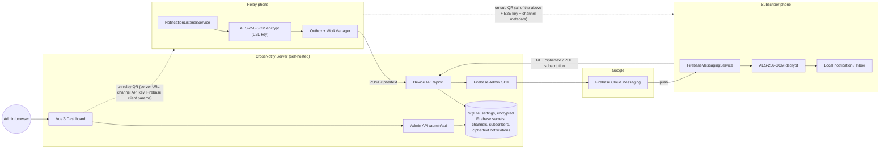
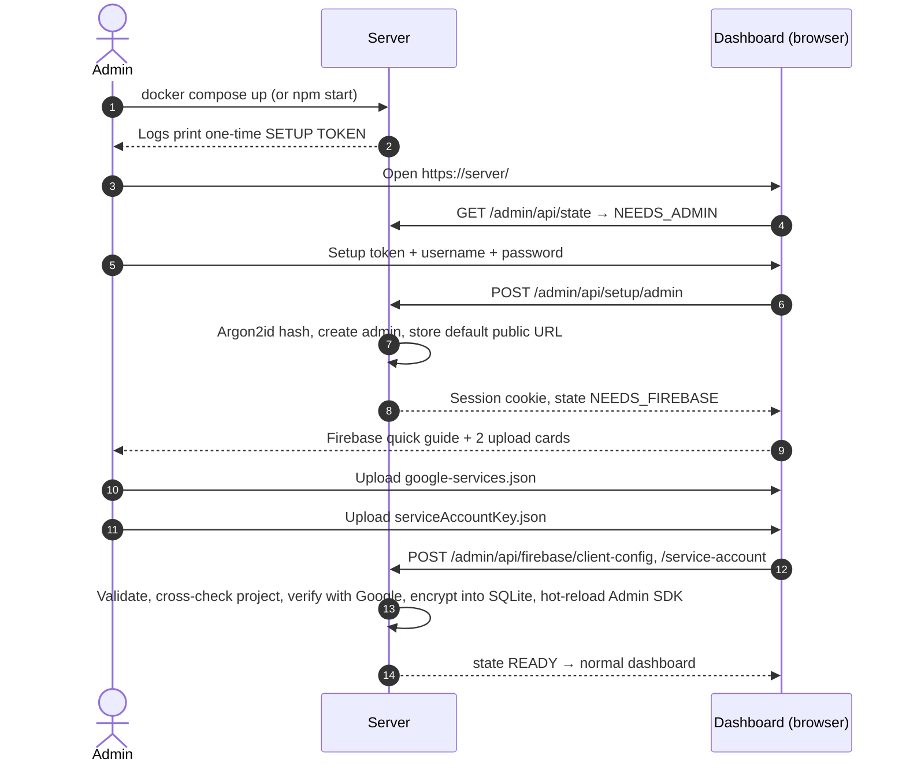
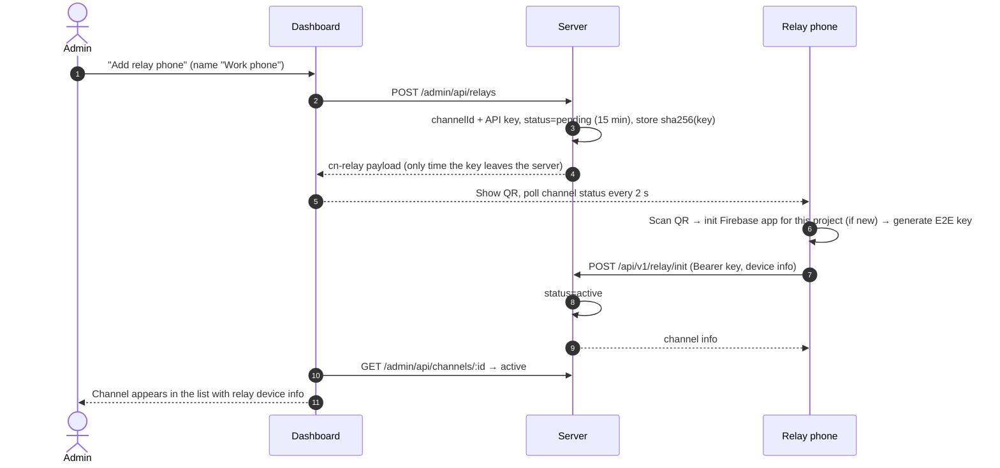
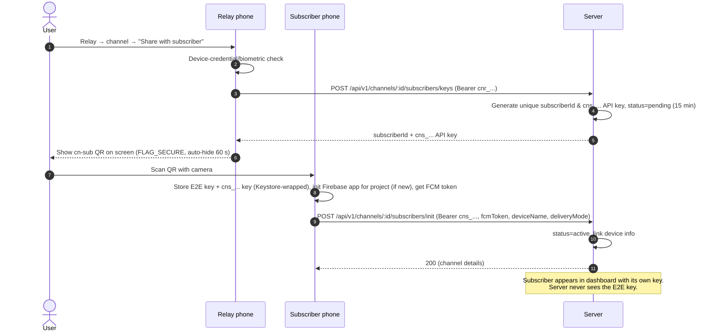
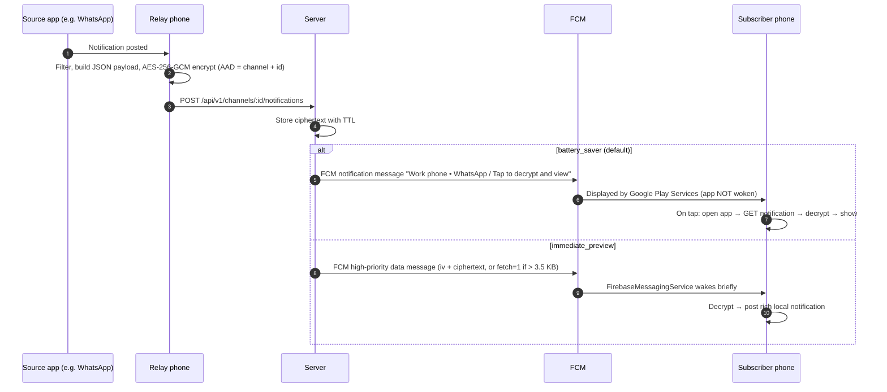

# CrossNotify — System Architecture & Implementation Plan

> **Audience**: coding agents and contributors. This is the **master specification**.
> Related documents:
> - [OVERHAUL_SERVER.md](./OVERHAUL_SERVER.md): detailed server and dashboard implementation spec
> - [FIREBASE_SETUP_GUIDE.md](./FIREBASE_SETUP_GUIDE.md): how end users create the two Firebase files
> - [server/README.md](./server/README.md): server operator documentation

---

## 1. Overview

**CrossNotify** relays Android notifications from one phone (a **relay**) to one or more other phones (**subscribers**). Notifications are **end-to-end encrypted**: they are encrypted on the relay phone and decrypted only on subscriber phones. The self-hosted server stores and forwards ciphertext it cannot read. Delivery uses **Firebase Cloud Messaging (FCM)**, which is free, to avoid battery-draining background connections.

CrossNotify is released as an **open-source, self-hosted** system:
- Users run **their own server** (locally, on a home server, or on a cloud VM).
- Users create **their own Firebase project**. No shared Firebase project is provided.
- Users install a **single precompiled APK**. The app configures Firebase **at runtime** from QR codes, so nobody needs to compile anything.

### Design principles
1. **Zero-knowledge server**: E2E keys are generated on the relay phone and shared with subscribers only through a QR code scanned in person. The server and Google never see notification content or E2E keys.
2. **Physical-proximity pairing**: every trust relationship is established by scanning a QR code on a nearby screen.
3. **Battery first**: no persistent sockets. FCM wakes the device, and the default delivery mode doesn't even wake the app.
4. **Zero-config deployment**: a server is configured entirely through its web dashboard, and a phone entirely through QR codes.
5. **Multi-role, multi-server**: any phone can be a relay for several channels and subscribe to several channels on several servers, each possibly backed by a different Firebase project. Daisy chaining comes naturally from this.

---

## 2. Terminology

| Term | Meaning |
| :--- | :--- |
| **Server** | A CrossNotify server instance (Node.js + Express + SQLite + Vue dashboard), bound to exactly one Firebase project |
| **Admin** | The person who operates a server through its dashboard (single account per server) |
| **Channel** | A one-way notification stream from one relay phone to N subscribers on one server. Identified by a server-generated UUID |
| **Channel API key** | Server-generated secret (`cnk_…`), one per channel. Authenticates the relay and the channel's subscribers to the server |
| **E2E key** | 256-bit AES key generated **on the relay phone**, one per channel. Encrypts notification content. Never sent to the server |
| **Relay phone** | A phone running CrossNotify whose *Relay* section holds one or more relay channels |
| **Subscriber phone** | A phone running CrossNotify whose *Subscriptions* section holds one or more subscriptions |
| **Relay provisioning QR** (`cn-relay`) | Shown by the **server dashboard**. Turns a phone into the relay of a new channel |
| **Subscriber pairing QR** (`cn-sub`) | Shown by the **relay phone**. Subscribes another phone to that channel. Contains the E2E key |

> [!IMPORTANT]
> There are exactly **two** QR codes in the system. The **dashboard** produces `cn-relay`. The **relay phone** produces `cn-sub`. The server can never produce a subscription QR because it never has the E2E key.

---

## 3. Architecture



### What each party knows

| Data | Server | Google (FCM) | Relay | Subscriber |
| :--- | :---: | :---: | :---: | :---: |
| Notification title/text | ❌ | ❌ | ✅ | ✅ |
| E2E key | ❌ | ❌ | ✅ | ✅ |
| Channel API key | hash only | ❌ | ✅ | ✅ |
| Channel name, relay device name | ✅ | battery-saver title only | ✅ | ✅ |
| Source app name (e.g. "WhatsApp") | ✅ (optional, per channel) | battery-saver title only | ✅ | ✅ |
| Timing and volume of notifications | ✅ | ✅ | ✅ | ✅ |
| Firebase service account key | ✅ (encrypted at rest) | – | ❌ | ❌ |
| Firebase client params (public identifiers) | ✅ | – | ✅ | ✅ |

---

## 4. End-to-End Flows

### 4.1 Server setup (one time)



### 4.2 Relay provisioning (dashboard → relay phone)



### 4.3 Subscriber pairing (relay phone → subscriber phone, in person)



### 4.4 Notification delivery



### 4.5 Catch-up sync
When the app opens (and when the device regains connectivity, via WorkManager with a network constraint), each subscription calls `GET /api/v1/channels/:id/notifications?since=<lastReceivedAt>` and pages through until `hasMore=false`. The notifications go into the local inbox. Deduplication is by `notificationId`.

### 4.6 Daisy chaining
A phone that subscribes to channel A (server 1) and relays channel B (server 2) can forward A → B:
- A subscription has an optional setting, **"Forward to relay channel"** (pick one of this phone's relay channels).
- Forwarding requires that subscription to use **`immediate_preview`**, because content must be decrypted on arrival. The UI enforces this.
- Forwarding is done **internally**: decrypt with A's key, re-encrypt with B's key, and enqueue in B's outbox. It does **not** go through the NotificationListenerService. The listener **always ignores CrossNotify's own package**, so locally displayed notifications are never re-captured.
- **Loop prevention**: the encrypted payload carries `origin { id, hops, path[] }`. Each hop increments `hops` and appends the outgoing channel ID to `path`. The payload is dropped if `hops >= 3` or the target channel ID is already in `path`. The original `origin.id` is kept, so every phone deduplicates by origin ID as well.

---

## 5. QR Code Formats

Both QR codes encode **UTF-8 JSON** (byte mode, error correction level M). The `t` field identifies the type. The app rejects unknown `t` values and `v` values greater than it supports. The app also rejects `http://` server URLs unless the user explicitly confirms a "local network / insecure" warning.

### 5.1 `cn-relay`: relay provisioning (shown by the dashboard)
```json
{
  "t": "cn-relay",
  "v": 1,
  "server":   { "url": "https://notify.example.com", "name": "Home Server" },
  "channel":  { "id": "3f1c…-uuid", "name": "Work phone", "color": "#4F46E5" },
  "apiKey":   "cnr_…",
  "firebase": { "projectId": "crossnotify-xyz", "appId": "1:1234567890:android:abc123", "apiKey": "AIza…", "senderId": "1234567890" },
  "exp": 1792014958000
}
```

### 5.2 `cn-sub`: subscriber pairing (shown by the relay phone)
```json
{
  "t": "cn-sub",
  "v": 1,
  "server":   { "url": "https://notify.example.com", "name": "Home Server" },
  "channel":  { "id": "3f1c…-uuid", "name": "Work phone", "color": "#4F46E5", "relayDevice": "Pixel 8 Pro" },
  "apiKey":   "cns_…",
  "firebase": { "projectId": "crossnotify-xyz", "appId": "1:1234567890:android:abc123", "apiKey": "AIza…", "senderId": "1234567890" },
  "e2e":      { "alg": "A256GCM", "kid": "k1", "key": "<base64url 32 bytes>" }
}
```

> [!NOTE]
> The `apiKey` in `cn-sub` is a **unique subscriber API key (`cns_...`)** minted specifically for this subscriber by the server via `POST /api/v1/channels/:id/subscribers/keys`. Revoking this subscriber on the server invalidates only this key.

> [!CAUTION]
> A `cn-sub` QR gives full read access to a channel. The relay app must show it only after a device credential / biometric check (`BiometricPrompt` with `DEVICE_CREDENTIAL` allowed), with `FLAG_SECURE` set on the window (blocks screenshots and screen recording), and must auto-hide it after 60 seconds.

---

## 6. Cryptography

### 6.1 End-to-end notification encryption (relay ↔ subscribers)
- **Algorithm**: AES-256-GCM, 12-byte random IV per message (never reused), 128-bit tag.
- **Key**: 32 bytes from `SecureRandom`, generated by the relay **after** a successful `relay/init`. `kid = "k1"` is reserved for future key rotation.
- **AAD** (associated data): UTF-8 string `cn1|<channelId>|<notificationId>`. This binds each ciphertext to its channel and ID, so the server can't swap blobs between channels or IDs without detection.
- **Encoding on the wire**: `iv` and `ciphertext` (tag appended) as base64url without padding.
- **Plaintext payload** (JSON, UTF-8):
```json
{
  "v": 1,
  "id": "notification-uuid",
  "pkg": "com.whatsapp",
  "app": "WhatsApp",
  "title": "Alice",
  "text": "Are we still meeting today?",
  "subText": "",
  "bigText": "…",
  "category": "msg",
  "postedAt": 1792014058000,
  "origin": { "id": "original-notification-uuid", "hops": 0, "path": ["3f1c…-uuid"] }
}
```
- **Limits**: `title` ≤ 200 chars, `text` ≤ 1000, `bigText` ≤ 4000 (truncate with "…"). Icons and images are **not** relayed in v1.

### 6.2 Server-side secrets
See [OVERHAUL_SERVER.md §5](./OVERHAUL_SERVER.md#5-cryptography-on-the-server). In summary:
- Admin password is hashed with Argon2id.
- Session tokens and channel API keys are stored as SHA-256 hashes.
- Firebase files are encrypted with AES-256-GCM using a master key (`CROSSNOTIFY_SECRET` env var or an auto-generated `DATA_DIR/secret.key`).

### 6.3 On-device secrets (Android)
- A non-exportable **Android Keystore** AES-256-GCM key (alias `cn_master`, StrongBox-backed when available) encrypts the sensitive columns in Room: channel API keys and E2E keys.
- `androidx.security:security-crypto` (`EncryptedSharedPreferences`) is **deprecated** and must not be used.
- The local inbox stores **ciphertext** (exactly as received) and decrypts it when displayed.
- Set `android:allowBackup="false"` and exclude the database from device-transfer backups, because the Keystore key cannot be restored on another device anyway.

---

## 7. Push Architecture

### 7.1 Cost
FCM is **free**, with no charge per message. Each user's own Firebase project (Spark / free plan) is enough.

### 7.2 Delivery modes (chosen per subscription on the subscriber phone)

| | `battery_saver` (default) | `immediate_preview` |
| :--- | :--- | :--- |
| FCM message type | Notification message | High-priority data message |
| App woken on arrival | **No**. Google Play Services shows it | Yes, briefly (decrypt + post) |
| Tray shows | `Work phone • WhatsApp` / *Tap to decrypt and view* | Real sender and text |
| Lock-screen privacy | High | Normal (follows system settings) |
| Smartwatch mirroring of content | No | Yes |
| Can be forwarded (daisy chain) | No | Yes |

### 7.3 Runtime Firebase configuration on Android & Multi-Project Fallback
- The APK is built **without** the `com.google.gms.google-services` Gradle plugin and **without** a bundled `google-services.json`. Automatic default-app creation is disabled in the manifest via `tools:node="remove"` on `FirebaseInitProvider`.
- For each distinct Firebase project found in scanned QR codes, the app creates a **named** `FirebaseApp`:
```kotlin
val options = FirebaseOptions.Builder()
    .setProjectId(fb.projectId)
    .setApplicationId(fb.appId)
    .setApiKey(fb.apiKey)
    .setGcmSenderId(fb.senderId)
    .build()
val app = FirebaseApp.initializeApp(context, options, "cn_${fb.projectId}")
val token = app.get(FirebaseMessaging::class.java).token.await()
```
- Named apps are re-initialized on every process start (in `Application.onCreate`) from the `servers` table.
- All projects' messages arrive in the single `FirebaseMessagingService`. Messages are routed by the `channelId` data field.
- **Token refresh**: `onNewToken` is only reliable for the default app. A daily `PeriodicWorkRequest` (plus a check on app start) re-reads the token of every named app and calls `PUT /api/v1/channels/:id/subscribers/self` if it changed.
- **Package name**: users register `com.crossnotify.app` in their Firebase project.

#### What is the Multiple Firebase Fallback?
- **The Issue**: Standard Firebase documentation assumes a single, build-time Firebase project initialized as the `[DEFAULT]` app. Some internal routines in Google Play Services / Firebase libraries invoke `FirebaseApp.getInstance()` (which expects a `[DEFAULT]` app) and may throw an `IllegalStateException` if zero default apps exist.
- **The Fallback Strategy**:
  1. When the phone pairs with its **first** server, CrossNotify initializes that project as **both** `[DEFAULT]` (calling `FirebaseApp.initializeApp(context, options)`) and `cn_${fb.projectId}`.
  2. Any **subsequent** servers scanned are initialized as named apps (`cn_${fb.projectId}`).
  3. Google Play Services delivers incoming pushes for all sender IDs to CrossNotify's single `FirebaseMessagingService.onMessageReceived(msg)`.
  4. The service reads `msg.data["channelId"]`, looks up the channel in Room, and decrypts with that channel's key.
  5. If the first server is removed, CrossNotify automatically promotes the next active server to `[DEFAULT]`.
  6. This fallback guarantees complete SDK stability across all Android versions (API 26 through 16+) with zero user friction.

---

## 8. Server (summary)

Full specification: **[OVERHAUL_SERVER.md](./OVERHAUL_SERVER.md)**.

- **Stack**: Node.js 22 + TypeScript + Express 5 + better-sqlite3 + firebase-admin. Dashboard in **Vue.js 3 (SFC, `<script setup lang="ts">`) + Vite + Vue Router + Pinia**.
- **First run**: a setup token in the logs is used to create the admin account. Then the admin uploads both Firebase JSON files, which are encrypted into SQLite. The server becomes `READY`.
- **Normal UI**: channel list, "Add relay phone" (shows the `cn-relay` QR and polls until the relay initializes), channel detail with subscribers, settings.
- **Device API** `/api/v1`: `relay/init`, publish, catch-up, single fetch, subscriber upsert and delete, and channel close. Auth is `Bearer` with a per-channel API key.
- **Retention**: encrypted notifications are kept for a configurable TTL (default 48 h). Expired data is pruned automatically.
- **Deployment**: Docker image with a persistent volume. Optional Caddy profile for automatic HTTPS. Needs a host with a persistent disk (Oracle Cloud Always Free VM, Google Cloud e2-micro, AWS Lightsail/EC2, Fly.io with a volume, home server or Raspberry Pi).

---

## 9. Android App Specification

### 9.1 Stack
| Area | Choice |
| :--- | :--- |
| Language / UI | Kotlin, Jetpack Compose, Material 3, Navigation Compose |
| Min / target SDK | minSdk 26 (Android 8.0) / latest stable targetSdk |
| Architecture | MVVM + repositories, Kotlin Coroutines/Flow, Hilt for DI |
| Persistence | Room (with sensitive columns encrypted via the Keystore key, §6.3) |
| Background | WorkManager (outbox sending, catch-up sync, token refresh) |
| Networking | Retrofit + OkHttp + kotlinx.serialization |
| Push | `firebase-messaging` via Firebase BoM `35.0.0`, **no** google-services plugin, **no** analytics |
| QR scan | CameraX + ML Kit Barcode Scanning (bundled model, works offline) |
| QR display | ZXing core (`com.google.zxing:core`) to render a bitmap |
| Auth for QR reveal | `androidx.biometric` (`BIOMETRIC_STRONG or DEVICE_CREDENTIAL`) |
| Package name | `com.crossnotify.app` |

### 9.2 Local data model (Room)
```
servers(id PK, url UNIQUE, name, fbProjectId, fbAppId, fbApiKey, fbSenderId, fbAppName, insecureHttpAccepted)
relay_channels(channelId PK, serverId FK, name, color, apiKeyEnc, e2eKeyEnc, kid, filterMode['allow_list'|'deny_list'],
               sendAppName BOOL, active BOOL, createdAt)
relay_app_filters(channelId FK, packageName, PRIMARY KEY(channelId, packageName))
subscriptions(channelId PK, serverId FK, subscriberId UUID, name, color, relayDevice, apiKeyEnc, e2eKeyEnc, kid,
              deliveryMode['battery_saver'|'immediate_preview'], lastReceivedAt, forwardToRelayChannelId NULL,
              lastRegisteredFcmToken, status['active'|'revoked'])
inbox(notificationId PK, channelId FK, originId, iv, ciphertext, appName, relayTimestamp, receivedAt, readAt NULL)
outbox(notificationId PK, channelId FK, iv, ciphertext, appName, createdAt, attempts, lastError)
seen_origins(originId PK, seenAt)          -- dedupe for daisy chains, pruned after 7 days
```
A `servers` row is created or reused (matched by URL) when either QR type is scanned. When a scanned QR contains Firebase parameters that differ from the stored ones for the same URL (the server switched projects), the user is asked to confirm and the stored parameters are updated.

### 9.3 Screens
- **Onboarding / Permissions health**: explains and requests each permission, and shows a green or red status for:
  - Notification access (relay, only if any relay channels exist)
  - `POST_NOTIFICATIONS` (Android 13+)
  - Camera (requested when scanning)
  - Battery optimization exemption (relay only, optional but recommended; OEM-specific tips such as dontkillmyapp.com)
- **Home**: bottom navigation **Relay** | **Subscriptions** | **Inbox** | **Settings**
- **Relay tab**
  - List of relay channels (name, colour, server, active state, today's count).
  - "Add relay channel" → scanner (accepts only `cn-relay`) → shows server and channel name for confirmation → `relay/init` → generates the E2E key → done.
  - Channel detail: app filter (installed apps list with search, allow-list or deny-list), "Show app name in battery-saver notifications" toggle, subscriber count (from `GET /api/v1/channels/:id`), **"Share with subscriber"** (auth-gated `cn-sub` QR), "Remove channel" (calls `DELETE /api/v1/channels/:id`).
- **Subscriptions tab**
  - List of subscriptions (name, colour, relay device, server, delivery mode, unread count).
  - "Add subscription" → scanner (accepts only `cn-sub`) → confirm → register.
  - Subscription detail: delivery mode toggle (re-PUTs to the server), "Forward to relay channel" (only selectable in immediate mode), "Unsubscribe" (DELETE + wipe local keys and inbox).
- **Inbox tab**: decrypted list grouped by subscription. Tapping an item shows its full content.
- **Decrypt activity**: target of the `com.crossnotify.app.OPEN_NOTIFICATION` intent action (battery-saver taps). It reads `channelId` and `notificationId` from the extras, fetches, decrypts, displays, and marks the item read.
- **Settings**: device display name (sent to servers), insecure HTTP policy, about/licences.

### 9.4 Relay pipeline
1. `CrossNotifyListenerService : NotificationListenerService`, `onNotificationPosted(sbn)`:
   - Skip if: the package is our own, the notification is ongoing or a foreground-service notification, `FLAG_GROUP_SUMMARY` is set, or there is no title and no text.
   - For each **active relay channel** whose filter accepts `sbn.packageName`: build the payload (§6.1) and continue.
   - **Dedupe**: skip if the same `(channelId, sbn.key, hash(title+text))` was sent in the last 10 s, because apps often re-post updates.
2. Encrypt with the channel's E2E key and AAD, then insert into `outbox`.
3. Enqueue **expedited** `OneTimeWorkRequest` (unique per channel, `APPEND_OR_REPLACE`) with a `NetworkType.CONNECTED` constraint and exponential backoff. The worker POSTs each outbox item and deletes it on `200`/`201`.
4. Server responses: on `401` or `409` (channel revoked), mark the relay channel inactive and post one local warning notification.

### 9.5 Subscriber pipeline
- `CrossNotifyMessagingService : FirebaseMessagingService`, `onMessageReceived(msg)`:
  - Ignore messages without `cn == "1"`. Look up the subscription by `channelId`. If it is unknown, ignore the message.
  - `type == "notification"`:
    - With `iv`/`ct` present: decrypt (with AAD), insert into the inbox, post the local notification, and run the forwarding rule if configured.
    - With `fetch == "1"`: enqueue expedited work to fetch the notification by ID, then handle it the same way.
  - `type == "channel_revoked"`: mark the subscription as revoked, wipe its keys, and post an informational notification.
- Battery-saver messages never reach `onMessageReceived` while the app is in the background. Google Play Services shows them, and they are processed on tap (Decrypt activity) or during catch-up sync.
- If the app is in the **foreground**, notification messages *do* reach `onMessageReceived`. Treat them like `fetch == "1"`.
- **Notification channels** (created at app start): `crossnotify_relay` (used by the server's battery-saver messages, must exist), plus one channel per subscription named after it, for rich immediate-preview notifications. This lets users tune sound and importance per subscription.

### 9.6 Permissions (manifest)
`INTERNET`, `POST_NOTIFICATIONS`, `CAMERA`, `RECEIVE_BOOT_COMPLETED` (WorkManager), `REQUEST_IGNORE_BATTERY_OPTIMIZATIONS` (relay; justify in store listing), `USE_BIOMETRIC`. Declare the listener service with `BIND_NOTIFICATION_LISTENER_SERVICE`.

### 9.7 Network security
`network_security_config.xml`: cleartext disabled by default. Users who accept insecure HTTP for a specific server (LAN testing) get a scoped OkHttp configuration. The app must never silently downgrade to HTTP.

---

## 10. Repository Layout

```
CrossNotify/
├── CROSSNOTIFY_ARCHITECTURE_PLAN.md   # this file
├── OVERHAUL_SERVER.md                 # server + dashboard refactor spec
├── FIREBASE_SETUP_GUIDE.md            # end-user Firebase guide
├── .gitignore                         # excludes google-services.json, serviceAccountKey.json, data/, builds
├── server/                            # Node.js API + dashboard/ (Vue 3 SFC)
└── android/                           # Android app (to be created)
```
The developer's personal `google-services.json` and `serviceAccountKey.json` in the repository root are **for local testing only**. Upload them through the local dashboard. They are gitignored and never bundled into the APK or the Docker image.

---

## 11. Roadmap

| Phase | Scope | Spec |
| :--- | :--- | :--- |
| **0. Spike** | Multi-project FCM on Android without a default app (§7.3) | this doc |
| **1. Server overhaul** | DB migrations, crypto, setup and auth, Firebase upload, channels and device API, push refactor, tests | [OVERHAUL_SERVER.md](./OVERHAUL_SERVER.md) §1–§12, §14–§17 |
| **2. Dashboard** | Vue 3 SFC: setup, login, Firebase wizard, channels, add relay, channel detail, settings | [OVERHAUL_SERVER.md](./OVERHAUL_SERVER.md) §13 |
| **3. Android core** | Project setup, Room schema, Keystore crypto, E2E crypto module (with test vectors shared with the server), `FirebaseProjectManager`, API client, QR scan and render | §6, §7.3, §9.1–§9.2 |
| **4. Relay** | `cn-relay` scan + `relay/init`, listener, filters, outbox worker, `cn-sub` QR with auth gate | §9.3–§9.4 |
| **5. Subscriber** | `cn-sub` scan + register, messaging service, both delivery modes, Decrypt activity, inbox, catch-up, token refresh | §9.3, §9.5 |
| **6. Daisy chain & polish** | Forwarding rules, loop prevention, permissions health screen, OEM battery tips | §4.6 |
| **7. Release** | Signed release APK on GitHub Releases, Docker image on GHCR, documentation pass | – |

### Cross-cutting acceptance criteria
- A fresh user can go from zero to a working relay → subscriber pair using only: [FIREBASE_SETUP_GUIDE.md](./FIREBASE_SETUP_GUIDE.md), `docker compose up`, the dashboard, and the release APK on two phones.
- Grepping the server DB, the server logs, and the FCM payloads for a notification's plaintext text finds nothing.
- Revoking a channel from the dashboard stops delivery and marks the subscription revoked on subscriber phones.

---

## 12. Known Limitations (v1)
- **No E2E key rotation** in v1 (`kid` is reserved). Rotating means removing and re-adding the relay channel.
- **Metadata visibility**: channel names, relay device names, optional app names, and timing are visible to the server operator (and the battery-saver title is visible to Google).
- **Single admin** per server.
- **Text only**: icons, images, and notification actions are not relayed.
