# CrossNotify

<div align="center">

**Self-Hosted • End-to-End Encrypted • Battery-Friendly • Zero-Knowledge**

*Relay Android notifications securely from one phone to another through your own server and personal Firebase project.*

[](https://android.com)
[](server/)
[](server/dashboard/)
[](LICENSE)

</div>

---

## What is CrossNotify?

**CrossNotify** is a complete, self-hosted system that forwards Android notifications from one phone (a **Relay**, such as a work phone or secondary device) to one or more other phones (**Subscribers**, such as your personal phone).

Notifications are **end-to-end encrypted (E2E)** with **AES-256-GCM** before they ever leave the relay device. Your private server and Google only handle ciphertext they cannot read. Push delivery is handled efficiently by **Firebase Cloud Messaging (FCM)** using your own free Firebase project, eliminating battery-draining persistent background connections.

Everything is managed through a built-in, responsive **web dashboard**, and pairing is established entirely via physical proximity **QR code scanning**.

---

## Key Highlights

- 🔒 **Zero-Knowledge Architecture**: Encryption keys are generated locally on the relay phone using secure hardware entropy. Keys are transferred directly to subscriber phones via an in-person QR scan. The server and Google never see plaintext notifications or encryption keys.
- 🔋 **Battery-First Push Delivery**: Powered by FCM (free Spark tier). Supports two delivery modes:
  - **Battery Saver** (default): Delivered by Google Play Services without waking the app process. Tap the notification to fetch and decrypt on demand.
  - **Immediate Preview**: Wakes the app briefly in the background to decrypt and post full notifications immediately (supports smartwatches and lock screens).
- 📱 **Universal Android APK**: No hardcoded API keys or Firebase configs baked into the app. A single compiled APK dynamically configures itself at runtime to connect to any CrossNotify server by scanning a QR code.
- 🔑 **Per-Device API Keys & 1-Click Revocation**: Relays and individual subscribers receive dedicated API keys. The server dashboard allows instantly revoking any individual subscriber without disrupting other devices or the relay channel.
- 🖥️ **Turnkey Web Dashboard**: Complete web interface for first-run setup, encrypted Firebase credential management, relay channel provisioning, subscriber auditing, and retention configuration.
- 🛡️ **Defense in Depth**: Argon2id admin passwords, single-use server setup token, AES-256-GCM encrypted database credentials, Android Keystore StrongBox integration, and `FLAG_SECURE` biometric-gated QR sharing.
- ⛓️ **Daisy Chaining**: Seamlessly forward notifications across multiple servers (e.g., Phone A → Phone B on Server 1, Phone B → Phone C on Server 2) with built-in loop detection and hop tracking.

---

## How It Works

```mermaid
flowchart LR
    subgraph Server["Self-Hosted CrossNotify Server"]
        Dash["Web Dashboard (Vue 3)"]
        API["Express API + SQLite (Ciphertext Only)"]
        FA["Firebase Admin SDK"]
        Dash <--> API
        API <--> FA
    end

    subgraph Google["Google Infrastructure"]
        FCM["Firebase Cloud Messaging (Free)"]
    end

    subgraph RelayPhone["Relay Phone (e.g. Work Phone)"]
        NLS["NotificationListenerService"]
        Enc["AES-256-GCM Encrypt"]
        Outbox["Outbox / WorkManager"]
        NLS --> Enc --> Outbox
    end

    subgraph SubPhone["Subscriber Phone (e.g. Personal Phone)"]
        FMS["FirebaseMessagingService"]
        Dec["AES-256-GCM Decrypt"]
        Tray["Notification Tray / Local Inbox"]
        FMS --> Dec --> Tray
    end

    AdminBrowser(("Admin Browser")) -->|1. Setup Token + Firebase Credentials| Dash
    Dash -.->|2. cn-relay QR Provisioning| RelayPhone
    RelayPhone -.->|3. cn-sub QR In-Person Pairing | SubPhone
    Outbox -->|4. POST Ciphertext| API
    FA -->|5. Forward Push| FCM
    FCM -->|6. Wakeup Push| FMS
```



### What Each Component Knows

| Data Point | CrossNotify Server | Google (FCM) | Relay Phone | Subscriber Phone |
| :--- | :---: | :---: | :---: | :---: |
| **Notification Title & Text** | ❌ Never | ❌ Never | ✅ Plaintext | ✅ Decrypted |
| **End-to-End Encryption Key** | ❌ Never | ❌ Never | ✅ Generated here | ✅ Scanned via QR |
| **Channel & Device API Keys** | SHA-256 Hash only | ❌ Never | ✅ Holds relay key | ✅ Holds subscriber key |
| **Source App Name (e.g. WhatsApp)** | Optional (per channel) | Battery saver title only | ✅ | ✅ |
| **Timing & Volume of Pushes** | ✅ | ✅ | ✅ | ✅ |
| **Firebase Service Account Key** | ✅ (AES-256-GCM at rest) | – | ❌ | ❌ |

---

## Repository Structure

```
CrossNotify/
├── android/                         # Native Android client application
│   ├── app/                         # Jetpack Compose UI, Room DB, Hilt, WorkManager, FCM
│   ├── build.gradle.kts             # Gradle build configuration
│   └── README.md                    # Android setup, permissions, and compilation guide
├── server/                          # Self-hosted backend server & dashboard
│   ├── dashboard/                   # Web dashboard (Vue 3, Vite, Pinia, Tailwind/SFC)
│   ├── src/                         # Express API, SQLite database, Firebase Admin service
│   ├── docker-compose.yml           # Multi-stage Compose deployment (with Caddy HTTPS profile)
│   ├── Dockerfile                   # Optimized multi-stage production Dockerfile
│   └── README.md                    # Server configuration and environment variable reference
├── CROSSNOTIFY_ARCHITECTURE_PLAN.md # Master engineering specification
├── FIREBASE_SETUP_GUIDE.md          # Visual guide to generating Firebase credentials
├── OVERHAUL_SERVER.md               # Backend API and database architecture details
└── README.md                        # This document
```

---

## Full System Deployment Guide

Deploying CrossNotify involves five straightforward steps:
1. **Create your free Firebase project** to obtain the two credentials files.
2. **Deploy the server** via Docker Compose (with automatic HTTPS).
3. **Complete the web setup wizard** in your browser.
4. **Compile or install the Android client APK**.
5. **Provision the relay channel and pair subscriber phones**.

---

### Step 1: Firebase Project Setup

CrossNotify uses FCM for push delivery. You run your own Firebase project (on Google's free **Spark plan** — no credit card needed).

Follow the detailed steps in [FIREBASE_SETUP_GUIDE.md](FIREBASE_SETUP_GUIDE.md) to obtain:

1. **`google-services.json` (Client Configuration)**:
   - In the [Firebase Console](https://console.firebase.google.com/), create a project (e.g. `CrossNotify`).
   - Add an **Android app** with package name **`com.crossnotify.app`**.
   - Download the generated `google-services.json`.
2. **`serviceAccountKey.json` (Server Credentials)**:
   - Navigate to **Project Settings** → **Service accounts** tab.
   - Click **Generate new private key** and download the JSON file.
3. **Verify API V1 is Enabled**:
   - In **Project Settings** → **Cloud Messaging** tab, ensure **Firebase Cloud Messaging API (V1)** is **Enabled**.

---

### Step 2: Deploy the Server

The server runs on any Linux VM, container host, or home server with a persistent volume (e.g. Oracle Cloud Always Free, AWS Lightsail, Hetzner, DigitalOcean, Fly.io, or Raspberry Pi).

#### Option A: Docker Compose with Automatic HTTPS (Recommended)

Requires a domain or subdomain (e.g. `notify.yourdomain.com`) pointing to your server's public IP, with ports **80** and **443** open.

1. Clone the repository on your server:
   ```bash
   git clone https://github.com/your-username/CrossNotify.git
   cd CrossNotify/server
   ```

2. Generate a secure 32-byte master key:
   ```bash
   export CROSSNOTIFY_SECRET=$(openssl rand -base64 32)
   export DOMAIN=notify.yourdomain.com
   ```
   > [!TIP]
   > Save your `CROSSNOTIFY_SECRET` in a secure password manager. It encrypts your stored Firebase credentials in SQLite.

3. Start CrossNotify with the Caddy automatic HTTPS profile:
   ```bash
   docker compose --profile https up -d
   ```

4. Retrieve the one-time **setup token** from the logs:
   ```bash
   docker compose logs crossnotify | grep -A2 "setup token"
   ```

#### Option B: Docker Compose (HTTP / Behind Existing Reverse Proxy)

If you already use Nginx, Traefik, or Cloudflare Tunnel:

```bash
cd server
export CROSSNOTIFY_SECRET=$(openssl rand -base64 32)
docker compose up -d
docker compose logs crossnotify | grep -A2 "setup token"
```
The server will listen on port `3000`.

#### Option C: Native Node.js Deployment

```bash
cd server
npm install
npm run build      # Builds both the Vue 3 dashboard and TypeScript API
npm start
```

---

### Step 3: Complete Dashboard Setup

1. Open your browser and navigate to your server's URL (e.g. `https://notify.yourdomain.com` or `http://localhost:3000`).
2. **Create Admin Account**:
   - Enter the one-time **setup token** obtained from the server logs.
   - Choose an admin username and a strong password (hashed with Argon2id).
3. **Upload Firebase Credentials**:
   - The setup wizard will prompt for both Firebase files.
   - Upload `google-services.json` (Client Config).
   - Upload `serviceAccountKey.json` (Server Credentials).
   - The server validates that both files belong to the same project, verifies connectivity with Google, encrypts them at rest into SQLite, and initializes the push service.
4. The dashboard transitions to the **READY** state!

---

### Step 4: Compile & Install the Android App

Detailed compilation steps, SDK requirements, and signing instructions are documented in [android/README.md](android/README.md).

#### Quick Build via Gradle Wrapper

1. Ensure **JDK 17+** and Android SDK Platform 36 are installed.
2. From the project root, navigate to `android/`:
   ```bash
   cd android
   ```
3. Compile the debug APK:
   - **Linux / macOS**: `./gradlew assembleDebug`
   - **Windows**: `.\gradlew.bat assembleDebug`
4. The compiled APK is ready at:
   ```
   android/app/build/outputs/apk/debug/app-debug.apk
   ```
5. Install the APK on your relay phone and all subscriber phones:
   ```bash
   adb install -r app/build/outputs/apk/debug/app-debug.apk
   ```

---

### Step 5: Provision Relay & Pair Subscribers

#### 1. Provision the Relay Phone
1. In the server dashboard, click **Add relay phone** and enter a name (e.g. `Work Pixel`).
2. The dashboard displays a **`cn-relay`** QR code containing the server URL, a unique relay API key, and Firebase client parameters.
3. Open CrossNotify on the **relay phone**, go to **Relay** → tap **Add relay channel**, and scan the QR code.
4. Grant the requested **Notification Access** permission.
5. In the channel settings, choose which apps you want to forward (Allow-list or Deny-list).

#### 2. Pair Subscriber Phones
1. On the **relay phone**, open the channel detail and tap **Share with subscriber**.
2. Authenticate with your fingerprint, face, or device PIN.
3. A secure **`cn-sub`** QR code is displayed on the relay screen (containing the E2E encryption key and a dedicated subscriber API key).
4. On the **subscriber phone**, open CrossNotify, go to **Subscriptions** → tap **Add subscription**, and scan the relay phone's screen.
5. Choose your delivery mode:
   - **Battery Saver**: Google Play Services displays a placeholder notification; tap to decrypt and read.
   - **Immediate Preview**: Decrypted instantly in the background for real-time tray notifications and smartwatch mirroring.
6. Done! Notifications from the selected apps on the relay phone will now be encrypted and relayed to your subscriber devices.

---

## Security & Privacy Design

- **Zero-Knowledge Architecture**: The server acts purely as a blind ciphertext store and forwarder. Payload Associated Authenticated Data (AAD) binds every ciphertext blob to its specific `channelId` and `notificationId`, preventing ciphertext manipulation or cross-channel replay attacks.
- **Physical Proximity Handshake**: End-to-end encryption keys are generated directly on the relay hardware and never traverse the network. They can only be acquired by physically scanning the relay phone's screen.
- **Screen Protection**: The subscriber QR screen enforces Android's `FLAG_SECURE` window attribute, preventing screenshots, display mirroring, and screen recording apps from capturing the E2E key.
- **Independent Subscriber Isolation**: Every subscriber is assigned a unique `cns_...` API key. If a subscriber phone is lost or compromised, the administrator can revoke that specific device with one click in the web dashboard, immediately terminating its access without affecting other paired devices.

---

## Backup & Maintenance

### Backing Up the Server
Your CrossNotify server stores its state in SQLite. To create a full backup:
1. Back up the Docker volume or directory:
   ```bash
   # If using Docker volume:
   docker run --rm -v crossnotify_server_crossnotify_data:/data -v $(pwd):/backup alpine tar czf /backup/crossnotify-data-backup.tar.gz /data
   ```
2. Securely store your `CROSSNOTIFY_SECRET` environment variable.

### Restoring
Extract the archive into your data volume or directory, set `CROSSNOTIFY_SECRET`, and start the container.

---

## Documentation Links

- 📖 **[Android Client Documentation](android/README.md)**: Build instructions, signing configs, background optimization tips, and Android architecture.
- 📖 **[Server Documentation](server/README.md)**: Server environment variables, reverse proxy configuration, and admin API overview.
- 📖 **[Firebase Setup Guide](FIREBASE_SETUP_GUIDE.md)**: Complete walkthrough for Google Firebase console configuration.
- 📖 **[System Architecture Plan](CROSSNOTIFY_ARCHITECTURE_PLAN.md)**: Comprehensive protocol specification and crypto flows.
- 📖 **[Server Overhaul Specification](OVERHAUL_SERVER.md)**: Database schemas, migration design, and REST endpoint definitions.

---

## License

This project is licensed under the open-source MIT / ISC License. See the [LICENSE](LICENSE) file for details.
