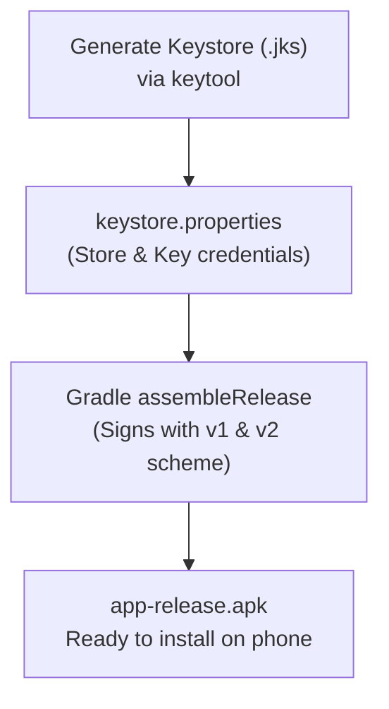

# CrossNotify — Android APK Signing & Release Guide

This guide walks you through generating a release keystore certificate, configuring Gradle signing properties securely, building a signed production APK, and installing it onto your Android device.

---

## Table of Contents

1. [Overview](#1-overview)
2. [Prerequisites](#2-prerequisites)
3. [Step 1: Generate the Release Keystore & Certificate](#step-1-generate-the-release-keystore--certificate)
4. [Step 2: Configure `keystore.properties`](#step-2-configure-keystoreproperties)
5. [Step 3: Gradle Signing Integration](#step-3-gradle-signing-integration)
6. [Step 4: Build the Signed Production APK](#step-4-build-the-signed-production-apk)
7. [Step 5: Verify the APK Signature](#step-5-verify-the-apk-signature)
8. [Step 6: Install on an Android Device](#step-6-install-on-an-android-device)
9. [Troubleshooting & Common Questions](#troubleshooting--common-questions)

---

## 1. Overview

Android requires all installed APKs to be digitally signed with a cryptographic certificate.
- **Debug builds**: Signed automatically by Gradle with a temporary, insecure debug key generated by the Android SDK.
- **Production/Release builds**: Require a private keystore (`.jks` or `.keystore`) containing a certificate with private/public key pairs to guarantee application integrity and authenticate the author.



---

## 2. Prerequisites

Ensure the following tools are available in your environment:

1. **Java Development Kit (JDK 17 or JDK 21)**:
   Verify by running:
   ```shell
   java -version
   keytool
   ```
2. **Android SDK & Build-Tools**:
   Required for `apksigner` and `adb`. Usually located at:
   - **Windows**: `%LOCALAPPDATA%\Android\Sdk\build-tools\<version>\`
   - **Linux / macOS**: `~/Android/Sdk/build-tools/<version>/`
3. **Gradle Wrapper**:
   Included in the `android/` directory (`gradlew` on Unix / `gradlew.bat` on Windows).

---

## Step 1: Generate the Release Keystore & Certificate

You generate an industry-standard **PKCS12** keystore using Java's built-in `keytool` utility.

### Option A: Windows PowerShell (Automated Random Password)

Run this snippet from the root of the CrossNotify repository:

```powershell
# 1. Generate a secure 24-character random password
$password = -join ((65..90) + (97..122) + (48..57) | Get-Random -Count 24 | ForEach-Object {[char]$_})

# 2. Keystore target path inside android/app/
$keystorePath = "android\app\release.jks"
if (Test-Path $keystorePath) { Remove-Item $keystorePath -Force }

# 3. Create the PKCS12 keystore with 10,000 days validity (~27 years)
keytool -genkeypair -v `
  -keystore $keystorePath `
  -alias crossnotify `
  -keyalg RSA `
  -keysize 2048 `
  -validity 10000 `
  -storetype PKCS12 `
  -storepass $password `
  -keypass $password `
  -dname "CN=CrossNotify, OU=CrossNotify, O=CrossNotify, C=IT"

# 4. Save credentials to android/keystore.properties
$propsContent = @"
storeFile=release.jks
storePassword=$password
keyAlias=crossnotify
keyPassword=$password
"@
Set-Content -Path "android\keystore.properties" -Value $propsContent -Encoding Ascii
Write-Host "Keystore created at $keystorePath and credentials saved to android/keystore.properties"
```

---

### Option B: Interactive Command Line (Linux, macOS, Git Bash, or Windows)

Navigate to the `android/app` directory and run:

```bash
cd android/app

keytool -genkeypair -v \
  -keystore release.jks \
  -alias crossnotify \
  -keyalg RSA \
  -keysize 2048 \
  -validity 10000 \
  -storetype PKCS12
```

Follow the prompts:
1. Enter and confirm your keystore password (make sure to remember or save this password).
2. Enter your Name, Organizational Unit, Organization, City, State, and Country Code.
3. Confirm with `yes`.

### Key Parameters Explained

| Parameter | Recommended Value | Description |
| :--- | :--- | :--- |
| `-keystore` | `release.jks` | Path and filename of the resulting keystore. |
| `-alias` | `crossnotify` | Identifier name for this specific key pair inside the keystore. |
| `-keyalg` | `RSA` | Cryptographic algorithm for key pair generation. |
| `-keysize` | `2048` | Size of the cryptographic key in bits (standard for Android). |
| `-validity` | `10000` | Number of days the certificate remains valid (~27 years). |
| `-storetype`| `PKCS12` | Modern, standard container format for keystores. |

> [!CAUTION]
> **Backup your keystore and passwords!**
> If you lose `release.jks` or forget the password, you will **not** be able to update an existing app installation on your phone without uninstalling the previous version first (which erases local app data and pairing).

---

## Step 2: Configure `keystore.properties`

CrossNotify avoids hardcoding passwords inside Gradle files. Instead, credentials are read from `android/keystore.properties`.

Create or edit `android/keystore.properties`:

```properties
storeFile=release.jks
storePassword=YOUR_SECRET_STORE_PASSWORD
keyAlias=crossnotify
keyPassword=YOUR_SECRET_KEY_PASSWORD
```

### Git Security

> [!IMPORTANT]
> The project's `.gitignore` is pre-configured to exclude sensitive credentials:
> ```gitignore
> *.jks
> *.keystore
> keystore.properties
> key.properties
> ```
> Never commit `keystore.properties` or `release.jks` to a public Git repository.

A sanitized template is provided in the repository as [`android/keystore.properties.example`](file:///c:/Users/Pas/Documents/Programmazione/Android/CrossNotify/android/keystore.properties.example) for reference.

---

## Step 3: Gradle Signing Integration

In [`android/app/build.gradle.kts`](file:///c:/Users/Pas/Documents/Programmazione/Android/CrossNotify/android/app/build.gradle.kts), the build script dynamically loads the properties if the file exists:

```kotlin
import java.io.FileInputStream
import java.util.Properties

val keystorePropertiesFile = rootProject.file("keystore.properties")
val keystoreProperties = Properties().apply {
    if (keystorePropertiesFile.exists()) {
        FileInputStream(keystorePropertiesFile).use { load(it) }
    }
}

android {
    ...
    signingConfigs {
        create("release") {
            if (keystorePropertiesFile.exists()) {
                val storeFilePath = keystoreProperties.getProperty("storeFile") ?: "release.jks"
                val store = file(storeFilePath)
                storeFile = if (store.exists()) store else rootProject.file(storeFilePath)
                storePassword = keystoreProperties.getProperty("storePassword")
                keyAlias = keystoreProperties.getProperty("keyAlias")
                keyPassword = keystoreProperties.getProperty("keyPassword")
                enableV1Signing = true
                enableV2Signing = true
            }
        }
    }

    buildTypes {
        release {
            isMinifyEnabled = false
            proguardFiles(
                getDefaultProguardFile("proguard-android-optimize.txt"),
                "proguard-rules.pro"
            )
            if (keystorePropertiesFile.exists()) {
                signingConfig = signingConfigs.getByName("release")
            }
        }
    }
}
```

- If `keystore.properties` **exists**: Gradle automatically applies the `release` signing configuration.
- If `keystore.properties` **is absent**: Gradle builds an unsigned release APK (`app-release-unsigned.apk`) without failing the build.

---

## Step 4: Build the Signed Production APK

Run the Gradle `assembleRelease` task from the `android` directory:

### Windows (PowerShell or CMD)
```powershell
cd android
.\gradlew.bat assembleRelease
```

### Linux / macOS
```bash
cd android
./gradlew assembleRelease
```

### Build Output Location

When the build finishes with `BUILD SUCCESSFUL`, the signed APK is generated at:
```
android/app/build/outputs/apk/release/app-release.apk
```

---

## Step 5: Verify the APK Signature

To ensure the APK was signed properly before transferring it to a device, verify it with `apksigner`.

### Using `apksigner`

Run the following command (substitute the path to your Android SDK `build-tools` version):

#### Windows PowerShell:
```powershell
& "$env:LOCALAPPDATA\Android\Sdk\build-tools\36.0.0\apksigner.bat" verify --verbose --print-certs .\android\app\build\outputs\apk\release\app-release.apk
```

#### Linux / macOS:
```bash
~/Android/Sdk/build-tools/36.0.0/apksigner verify --verbose --print-certs ./android/app/build/outputs/apk/release/app-release.apk
```

### Expected Output:
```text
Verifies
Verified using v1 scheme (JAR signing): true (or false if v2-only)
Verified using v2 scheme (APK Signature Scheme v2): true
Number of signers: 1
Signer #1 certificate DN: CN=CrossNotify, OU=CrossNotify, O=CrossNotify, C=IT
Signer #1 certificate SHA-256 digest: 2af350c450d156a7add5bd0ec95ef84ec6c834cf9b508668992df628ae12f727
Signer #1 certificate SHA-1 digest: 739a7a693ef47a39f2145e600e576b5fb34927d9
```

---

## Step 6: Install on an Android Device

### Option A: Install via ADB (Recommended for Developers)

1. Enable **Developer Options** and **USB Debugging** on your phone.
2. Connect your phone via USB cable and allow debugging when prompted.
3. Install the APK directly:
   ```shell
   adb install -r android/app/build/outputs/apk/release/app-release.apk
   ```

> [!NOTE]
> The `-r` flag reinstalls existing applications while retaining application data.

---

### Option B: Sideloading (Manual Installation)

1. Transfer `app-release.apk` to your phone using any of the following methods:
   - USB File Transfer (MTP)
   - Cloud storage (Google Drive, Nextcloud, OneDrive)
   - Messaging app (Telegram Saved Messages, email attachment)
2. Open the device's **Files** or **Downloads** app.
3. Tap `app-release.apk`.
4. If prompted, enable **"Install unknown apps"** or **"Allow from this source"** for your file browser.
5. Tap **Install** (or **Update**).

---

## Troubleshooting & Common Questions

### 1. `INSTALL_FAILED_UPDATE_INCOMPATIBLE`
**Error Message:**
> `Failure [INSTALL_FAILED_UPDATE_INCOMPATIBLE: Existing package com.crossnotify.app signatures do not match newer version]`

**Cause:** You already have a debug version of CrossNotify installed on your phone. Android prohibits updating an app if the new APK is signed with a different key than the installed one.

**Solution:** Uninstall the existing debug app from your phone first:
```shell
adb uninstall com.crossnotify.app
```
Then reinstall the release APK.

---

### 2. Output is named `app-release-unsigned.apk` instead of `app-release.apk`
**Cause:** Gradle did not detect `keystore.properties` or could not locate the keystore file.

**Solution:**
1. Check that `android/keystore.properties` exists.
2. Verify that `storeFile=release.jks` points to the actual file location (e.g. `android/app/release.jks`).
3. Re-run `.\gradlew.bat assembleRelease`.

---

### 3. "Could not connect to the Gradle daemon"
**Cause:** Local socket restrictions or firewall software blocking Gradle's internal communication on localhost loopback.

**Solution:**
Run Gradle with `--no-daemon`:
```shell
cd android
.\gradlew.bat assembleRelease --no-daemon
```

---

### 4. How to retrieve the SHA-256 fingerprint from the Keystore directly?
If you ever need the SHA-256 fingerprint (for instance, to configure Google Play Services or Firebase App Check):

```shell
keytool -list -v -keystore android/app/release.jks -alias crossnotify
```
Enter the keystore password when prompted, and look for the `SHA256:` line.
