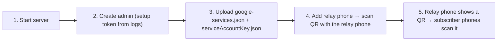

# CrossNotify Server

The CrossNotify server stores **end-to-end encrypted** notifications from relay phones and forwards them to subscriber phones through **your own Firebase project**. Everything is managed from a built-in **web dashboard** (Vue.js 3). There are no config files to edit.

## Features
- **Zero-knowledge**: only ciphertext is stored. Encryption keys are created on the relay phone and never reach the server.
- **Web dashboard**: first-run setup wizard, Firebase upload, relay phone provisioning by QR code, channel and subscriber management.
- **Secure by default**: Argon2id admin password, one-time setup token, Firebase credentials encrypted at rest, one API key per relay channel (stored only as a hash), rate limiting, Helmet security headers.
- **Battery-friendly delivery**: *battery saver* mode (FCM notification messages, the subscriber app isn't woken) or *immediate preview* mode (FCM data messages, decrypted on arrival).
- **Automatic retention**: encrypted notifications expire after a configurable time (default 48 h).
- **Single container**: Node.js + SQLite, with an optional automatic-HTTPS profile using Caddy.

---

## How It Works



1. **Start the server** (see Quick Start). On first boot, the logs print a **setup token**.
2. **Open the dashboard** at your server's URL. Enter the setup token and choose an admin username and password.
3. **Firebase setup**: follow the in-dashboard guide (or [FIREBASE_SETUP_GUIDE.md](../FIREBASE_SETUP_GUIDE.md)) and upload both JSON files.
4. **Add a relay phone**: the dashboard shows a QR code. Scan it with the CrossNotify app on the phone whose notifications you want to relay (*Relay → Add relay channel*). The channel appears in the dashboard as soon as the phone registers.
5. **Add subscribers**: on the **relay phone**, open the channel and tap *Share with subscriber*. Other phones scan that QR (*Subscriptions → Add subscription*).

> [!IMPORTANT]
> Subscriber QR codes come **only from the relay phone**, because they contain the end-to-end encryption key. The dashboard deliberately can't create them.

---

## Quick Start

### Option A: Docker Compose (recommended)
```bash
cd server
docker compose up -d
docker compose logs crossnotify | grep -A2 "setup token"
```
Open `http://<host>:3000`.

**With automatic HTTPS** (needs a domain pointing to your server, with ports 80 and 443 open):
```bash
DOMAIN=notify.example.com docker compose --profile https up -d
```
Open `https://notify.example.com`.

### Option B: Node.js
```bash
cd server
npm install
npm run build     # builds the dashboard and the API
npm start
```
Development, with hot reload for the API and the dashboard:
```bash
npm run dev       # API on :3000
npm run dev:web   # Vite dev server with proxy to :3000
```

---

## Configuration (Environment Variables)

Only infrastructure settings live in the environment. Everything else (admin account, Firebase, public URL, server name, retention) is set in the dashboard.

| Variable | Default | Description |
| :--- | :--- | :--- |
| `PORT` | `3000` | HTTP port |
| `HOST` | `0.0.0.0` | Bind address |
| `DATA_DIR` | `./data` (`/app/data` in Docker) | Database and auto-generated master key |
| `CROSSNOTIFY_SECRET` | *(unset)* | Base64 32-byte master key that encrypts stored secrets. If unset, it's generated into `DATA_DIR/secret.key` |
| `CROSSNOTIFY_SETUP_TOKEN` | *(unset)* | Pre-set the first-run setup token instead of reading it from the logs |
| `TRUST_PROXY` | `false` | Set to `1` behind a reverse proxy or load balancer (Caddy, Nginx, Cloudflare) |
| `COOKIE_SECURE` | `auto` | Force the dashboard cookie's `Secure` flag (`true`/`false`) |
| `LOG_LEVEL` | `info` | `debug` \| `info` \| `warn` \| `error` |

Generate a master key:
```bash
openssl rand -base64 32
# Windows PowerShell:
[Convert]::ToBase64String((1..32 | ForEach-Object { Get-Random -Maximum 256 }) -as [byte[]])
```

---

## Security Model

### Setup token
A freshly deployed server could be found by a stranger before you finish setup. To prevent that, creating the admin account requires a one-time **setup token** that's printed only in the server logs. Once the admin exists, the setup endpoint is permanently disabled.

### Admin account
There's a single admin. The password is hashed with **Argon2id**. Dashboard sessions use an `HttpOnly`, `SameSite=Strict` cookie that lasts 7 days. Change the password in **Settings**.

### Firebase credentials
Both uploaded files are encrypted with **AES-256-GCM** using the master key, then stored in SQLite. The service account's private key is never shown again in the dashboard or the logs.

> [!TIP]
> For the strongest protection, set `CROSSNOTIFY_SECRET` as an environment variable (or a secret in your platform) instead of relying on `data/secret.key`. Then a copy of the `data/` folder or a database backup alone can't reveal your Firebase key.
> If the master key is lost, just re-upload the two Firebase files. Nothing else is affected.

### Per-Device API Keys & Individual Subscriber Revocation
There is **no global API key** anymore. Security is enforced through isolated, role-specific keys:
- **Relay Key (`cnr_...`)**:
  - When you click **Add relay phone**, the server generates a unique Relay API key embedded in the provisioning QR code. Stored only as a SHA-256 hash.
  - Used exclusively by the Relay phone to activate the channel, mint subscriber keys, and publish encrypted notifications.
- **Subscriber Key (`cns_...`)**:
  - When you tap **Share with subscriber** on the Relay phone, the Relay phone asks the server to mint a **brand-new, dedicated Subscriber API key**.
  - That key is embedded in the subscriber pairing QR code.
  - When the subscriber phone scans the QR code, it initializes its subscription with its own key and appears in the dashboard's subscriber table.
- **One-Click Individual Revocation in the Dashboard**:
  - In the dashboard's channel detail view, each subscriber phone has its own row with device name and a **Revoke** button.
  - Clicking Revoke instantly invalidates that subscriber's `cns_...` key and sends a revocation push.
  - That specific subscriber phone is immediately locked out from the server (cannot fetch missed messages or tap to decrypt).
  - All other subscribers and the relay channel continue working completely uninterrupted!

### What the server can and cannot see
| Can see | Cannot see |
| :--- | :--- |
| Channel names, relay device names, subscriber device names | Notification titles or text |
| Source app name (only if the relay enables it) | End-to-end encryption keys |
| When and how many notifications are sent | |

---

## Deployment Guide

CrossNotify uses SQLite, so it needs a **persistent disk**. Any VM or container host with a volume works.

| Platform | Notes |
| :--- | :--- |
| **Oracle Cloud Always Free** | ARM (Ampere A1) or AMD VM. Install Docker and run the HTTPS profile. Open ports 80/443 in the VCN security list **and** in the VM firewall (`iptables`/`firewalld`). |
| **Google Cloud e2-micro (free tier)** | Compute Engine VM in an eligible US region. Use Docker and the HTTPS profile. |
| **AWS Lightsail / EC2** | Small instance plus Docker and the HTTPS profile. |
| **Fly.io / Railway / Render** | Attach a **persistent volume** mounted at `/app/data`, set `TRUST_PROXY=1`, and use the platform's HTTPS. |
| **Home server / Raspberry Pi** | Docker Compose. Expose it through a reverse proxy, Cloudflare Tunnel, or Tailscale. |

> [!WARNING]
> **Serverless platforms without persistent disks** (e.g. plain Google Cloud Run, AWS Lambda) aren't supported. The database would be wiped on every restart or scale event.

### Example: Oracle Cloud Always Free VM
```bash
sudo apt-get update && sudo apt-get install -y docker.io docker-compose-plugin git
git clone https://github.com/PasSilvestri/CrossNotify.git && cd CrossNotify/server
export DOMAIN=notify.example.com
export CROSSNOTIFY_SECRET=$(openssl rand -base64 32)   # store this somewhere safe!
sudo -E docker compose --profile https up -d
sudo docker compose logs crossnotify | grep -A2 "setup token"
```

### Backups
Back up the `crossnotify_data` volume (the SQLite database) and, separately, your `CROSSNOTIFY_SECRET`. Notifications are short-lived, so a backup mainly preserves your admin account, Firebase setup, and channels.

---

## API Overview

Full request and response definitions are in [SERVER_DOCUMENTATION.md](../SERVER_DOCUMENTATION.md) §10 and §12.

**Public**
- `GET /health` → `{ "status": "ok", "state": "READY" }`

**Device API** (`/api/v1`, `Authorization: Bearer cnk_…`)
| Method & Path | Used by |
| :--- | :--- |
| `POST /api/v1/relay/init` | Relay (activates the channel after scanning the dashboard QR) |
| `GET /api/v1/channels/:channelId` | Relay / Subscriber |
| `DELETE /api/v1/channels/:channelId` | Relay (closes the channel) |
| `POST /api/v1/channels/:channelId/notifications` | Relay |
| `GET /api/v1/channels/:channelId/notifications?since=&limit=` | Subscriber (catch-up) |
| `GET /api/v1/channels/:channelId/notifications/:notificationId` | Subscriber |
| `PUT /api/v1/channels/:channelId/subscribers/:subscriberId` | Subscriber (register / update) |
| `DELETE /api/v1/channels/:channelId/subscribers/:subscriberId` | Subscriber (unsubscribe) |

**Admin API** (`/admin/api`, dashboard session cookie): used by the dashboard only.
